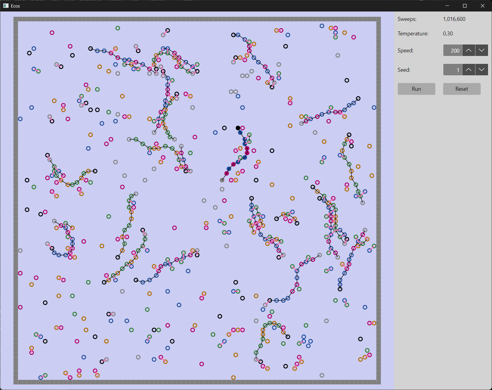

# Ecos

Ecos is an attempt to create digital life from simple chemistry. It simulates atoms on a 2D lattice that move, bond into strands, and copy those strands by pairing with a template. The goal is self-replication from raw materials that is robust enough for evolution by natural selection.

Replication is not scripted. The rules describe only local physics and chemistry: how atoms move, which bonds can form, and what they cost. Anything that looks like copying has to emerge from those rules.



*A world after five cold/hot cycles, during the sixth cold phase. It began with one 12-atom strand (the filled circles, centre) among free atoms. Every other strand is a descendant: a copy, or a copy of a copy. Black lines are strong bonds along a strand, pink lines are weak bonds between paired atoms, and the black and grey circles are the caps at each end of a strand.*

## Where it stands

A single strand placed among free atoms is copied, the copies separate when heated and are copied in turn, and the population grows until the world is full. One strand becomes about 3, then 6, then 9 or 10 over three cycles, after which space and free atoms run short.

| Milestone | Status |
|---|---|
| Polymer physics that matches exact enumeration | Done |
| Free atoms pair with a template strand | Done |
| Paired atoms join into a copy, and only on a template | Done |
| Copy separates cleanly from the template when heated | Done |
| Finished strands survive repeated cycles unchanged | Done |
| Population multiplies from cycle to cycle | Done, until the world fills up |
| Sustained exponential growth in a large world | Being measured |
| Turnover, so that a full world keeps changing | Not started |
| Sequences that differ in fitness, and selection between them | Not started |
| A phenotype beyond a strand's own copying rate | Not started |

Copying is not perfectly faithful. After three cycles roughly four capped strands in five are full length; most of the rest are one to three atoms short. These deletion mutants are capped and can be copied, so they are heritable variation, which nothing yet selects for or against.

## The model

### Atoms and the lattice

- The world is a 2D square lattice. Each atom occupies a 2×2 block of sites, and no two atoms may overlap.
- Atoms are never created or destroyed, so mass is conserved.
- Walls are immovable blocks the size of an atom, used to enclose a world.
- There are six atom types. W, X, Y and Z are the coding atoms that make up a strand's sequence. P and Q are caps that end a strand.

### Bonds

| | Strong bonds | Weak bonds |
|---|---|---|
| Role | Join atoms along a strand | Pair atoms on different strands |
| Which atoms | Any two, except two caps | Complementary types only: W–X, Y–Z, P–Q |
| Range | Longer (up to about 3.6 sites) | Shorter (up to about 2.8 sites) |
| Limit per atom | Two, or one for a cap | Two, and the second only for an atom in a strand |
| Angle rule | Stiff: at most about 37° of bend at each atom | An atom's two partners must be on opposite sides of it |
| Energy and barrier | Large energy, large barrier | Small energy, no barrier |
| Entropy | None | Pairing costs entropy, so pairs melt when hot |

No bond of either type may cross another.

### Dynamics

Time advances by single random events, accepted or rejected by the Metropolis rule at temperature kT:

- **Hop:** an atom moves one site, if that leaves it clear of other atoms and keeps all its bonds legal.
- **Toggle:** a bond between two atoms in range forms if absent or breaks if present. It must first cross the bond type's barrier and is then accepted according to its energy and entropy.

One *sweep* is one attempted event per atom.

### What makes copying happen

- **Stacks.** When two neighboring atoms of one strand are each paired with neighboring atoms of another, the two pairs form a stack. A stack adds binding energy.
- **Templated joining.** A stack also removes the barrier to the strong bond beside it. Two free atoms sitting side by side on a template therefore join readily, while two free atoms meeting anywhere else almost never do. This is the only route by which strands grow.
- **A barrier to starting.** Joining two free atoms, which starts a new strand, keeps a small barrier even on a template. Adding an atom to an existing strand does not. A copy therefore tends to grow from a few starts instead of many, which wastes fewer atoms on fragments and makes copies more faithful.
- **Caps.** A cap can have only one strong bond, so a strand that ends in caps cannot be extended. A cap is copied like any other atom, by pairing with its complement, so strand length is inherited. A strand has a P at one end and a Q at the other, which gives it a direction: read from P to Q, a copy is the reverse complement of its template.
- **Peeling.** A strong bond at an uncapped end of a strand breaks at a rate that rises with temperature. Unfinished strands melt back into free atoms during the hot phase, and finished, capped strands are untouched.
- **Bond entropy.** A weak bond has an entropy cost as well as an energy, so it has a melting point: stable when cold, and unlikely even between two atoms held in range when hot. Without this, paired strands stay stuck together at any temperature.
- **Temperature cycling.** A cold phase lets free atoms pair with strands and join into copies. A hot phase melts the weak bonds so strands separate, and peels away the fragments.

Every rule except peeling obeys detailed balance, so at a fixed temperature the model would settle into thermal equilibrium. Peeling is deliberately one-way. Together with the temperature cycle, it is what keeps the system out of equilibrium, with atoms flowing from the free pool into strands and back.

## What we learned getting here

Each rule above was added to fix a specific failure that showed up in measurement:

- **Flexible strands with two-sided pairing collapsed into globules.** Stiffness fixed this, and it had to be a limit on the angle itself; a limit on the raw dot product allowed sharp bends wherever bonds were stretched.
- **Free atoms kept switching roles between strand and partner.** Allowing a second weak partner only for an atom already in a strand fixed this.
- **Random joining during the hot phase.** A high barrier that only a stack removes fixed this.
- **Strands grew longer every cycle.** Measurement showed free atoms being added to strand ends, templated by a partner strand that had slid out of alignment. Caps fixed this.
- **Fragments accumulated and used up the free atoms,** and many were completed into three-atom capped strands that then multiplied faster than full-length ones. Peeling removes the fragments each cycle.
- **Strands stayed stuck together when hot.** A pair of atoms in range was bonded at least half the time at any temperature, because pairing had an energy but no entropy cost. Bond entropy fixed this.
- **Growth stalled for want of free atoms,** most of which were tied up in fragments during each cold phase. More atoms helped; the barrier to starting a strand cut the fragments by two thirds and removed most of the short and truncated copies as well.

Three ideas were tried and dropped because measurement did not support them: requiring two strong bonds for a second weak partner, four-letter templates, and (more than once) the guess that strands clumping into sheets was what limited growth.

## Open problems

- **A full world stops.** Capped strands last forever, so once space and atoms are used up nothing more happens. Evolution in a finite world needs turnover: strands must sometimes be destroyed and their atoms released, so that new copies replace old ones.
- **Short strands have an advantage.** A shorter strand needs fewer atoms and fewer joins. With turnover in place, the deletion mutants would be expected to take over. Something has to make length, or sequence, worth having.
- **No phenotype yet.** The candidates are different pairing strengths for the two letter pairs, strands that fold into shapes that do something, and closed rings that act as compartments. Folding would need strands that are flexible when single and stiff when paired; at present they are stiff always.
- **Two partners can share a face at a bend.** The weak angle rule keeps an atom's two partners on opposite sides of the atom, which at a sharp bend is not the same as opposite sides of the strand. It is rare and corrects itself, so it has been left alone.

## Repository layout

| Project | Contents |
|---|---|
| `Ecos` | The core library: atoms, bonds, parameters, the world, and the update rule |
| `Ecos.Desktop` | A desktop app (Avalonia) for watching a scenario run |
| `Ecos.Experiment` | Scenarios shared with the desktop app, and console experiments that measure them |
| `Ecos.Test` | Unit and property tests |
| `Avalonia.FuncUI` | Git submodule used by the desktop app |

## Building and running

The solution targets .NET 10. Clone with submodules:

```bash
git clone --recurse-submodules https://github.com/brianberns/Ecos
```

Run the desktop app:

```bash
dotnet run -c Release --project Ecos.Desktop
```

Run the tests:

```bash
dotnet test -c Release
```

Run an experiment, optionally naming a CSV file for the results:

```bash
dotnet run -c Release --project Ecos.Experiment -- experiment3 results.csv
```

| Experiment | Question |
|---|---|
| `experiment1` | What fraction of a template is paired at each temperature? |
| `experiment2` | How much faster do free atoms join when a template is present? |
| `experiment3` | Under temperature cycling, do copies form, separate intact, and multiply? |

Experiment 3 takes roughly twenty minutes. For each phase of each cycle it reports the number of strands, complete copies and capped strands, what was joined to what, the lengths of the capped strands, and the free atoms of each type.

## How the model is tested

- **Exact enumeration.** For systems small enough to list every state, the simulation's statistics are compared with the exact Boltzmann distribution, with and without bond entropy and the start barrier.
- **Independent oracles.** Each rule is restated separately in the tests, and the library is checked against that statement, exhaustively where the cases are few and by random worlds otherwise.
- **Event rates.** In crowded random worlds, each kind of event must happen as often as the rules predict.
- **Mutation checks.** Each new test is run against deliberately broken copies of the library, to confirm that it fails when it should.

## Background

The lattice model is the Bond Fluctuation Model of polymer physics, with Metropolis dynamics. The approach follows Tim Hutton's artificial chemistry work on self-replicating molecules, with the aim of more realistic physics and less built-in machinery. Growth by layering and fragmentation is related to the crystal-based replicators of Schulman, Yurke and Winfree. The advantage of short replicators echoes Spiegelman's experiments with RNA.

The core library is written by Brian Berns. The tests and experiments are written with Claude.
