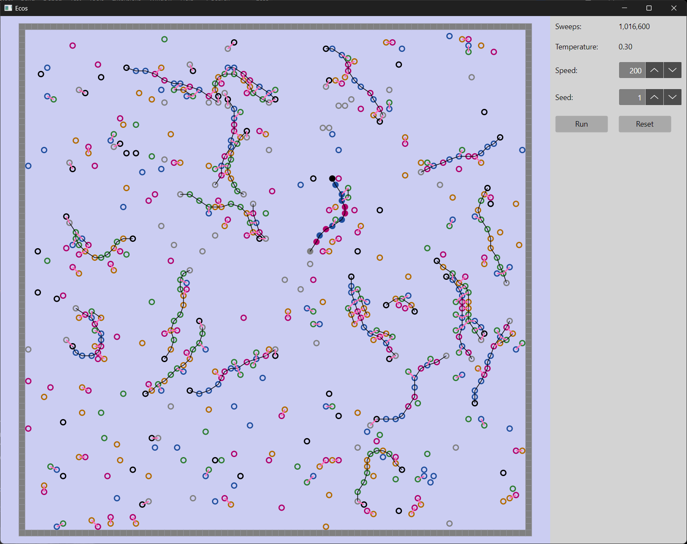

# Ecos

Ecos is an attempt to create digital life from simple chemistry. It simulates atoms on a 2D lattice that move, bond into strands, and copy those strands by pairing with a template. The goal is self-replication from raw materials that is robust enough for evolution by natural selection.

Replication is not scripted. The rules describe only local physics and chemistry: how atoms move, which bonds can form, and what they cost. Anything that looks like copying has to emerge from those rules.



*A world after five cold/hot cycles. It began with one 12-atom strand (the filled circles, centre) among free atoms. Every other strand is a descendant. Black lines are strong bonds along a strand, pink lines are weak bonds between paired atoms, and the black and grey circles are the caps at each end of a strand.*

## Where it stands

Strands replicate. A template among free atoms is copied in the cold, the copy separates in the heat, and both are copied again: one strand becomes about 2, 4 and 8 over three cycles. Replicators also arise by chance from free atoms, strands die and are recycled, and selection works on a heritable trait (pairing strength).

What's missing is a phenotype: a trait that does something, with costs and benefits, beyond being copied. The current work is on folding (below).

| Milestone | Status |
|---|---|
| Polymer physics that matches exact enumeration | Done |
| Free atoms pair with a template strand | Done |
| Paired atoms join into a copy, and only on a template | Done |
| Copy separates cleanly from the template when heated | Done |
| Finished strands survive repeated cycles unchanged | Done |
| Population multiplies from cycle to cycle | Done, until the world fills up |
| Sustained exponential growth in a large world | Partly: growth slows as the colony spreads, since strands drift slowly |
| Replicators arise from free atoms with no template | Done, though only very short ones (three atoms) |
| Turnover, so that a full world keeps changing | Done |
| Sequences that differ in fitness, and selection between them | Done, for pairing strength: a stronger pair's share rises from 0.5 to about 0.9 over 30 cycles |
| A phenotype that does something beyond being copied | In progress: under stress, strands that fold into a hairpin replace those that can't, in every run, but shorter folders then take over |
| Adaptation to a varied environment | Not yet |

## Current direction: folding to survive

**Hypothesis.** When food runs out, a strand that can fold back on itself into a hairpin protects itself, and one that can't is left exposed. Over cycles of plenty and want in a closed world, folders should outlast non-folders.

**Setup (experiment 28).** A closed 160×160 world, seeded with two *hairpin-formers* and two *non-formers*, among a fixed supply of free atoms. Nothing is added or removed. A hairpin-former, e.g. `P WWXWYXZXWW HH XXWYWZXWXX Q`, has two complementary arms around a hinge (H H) that bends freely, so it folds there into an 11-pair stem. It is its own reverse complement, so its copies are siblings. Its non-former has each arm's letters shuffled: the same length, atoms, hinge and caps, but it can't fold (at most 2 pairs within itself). Each cycle is:

1. a *feast*, cold (kT 0.25, 300,000 sweeps), for copying, or folding once food runs out;
2. a *stress*, just as cold (50,000 sweeps), in which a cap peels off unless a stack protects it, as one does in a duplex or a folded hairpin;
3. a *melt*, hot (kT 3, 200,000 sweeps), which separates duplexes and hairpins and unravels strands that lost a cap.

**Copying starts only at a primer.** Experiments 27 and 28 use new physics, in which copying and folding no longer get in each other's way:

- *Only a primer starts a strand.* The strong start barrier is infinite except between two H atoms (start barrier 0), so a copy can start only at a template's hinge. Copies no longer start on the arms of a half-folded strand, which used to make copies switch templates at the fork and produce palindromic junk.
- *Only stacked pairs last.* Weak pairs are weak (1.4, and 2.0 for H–H) and stacks modest (0.6), so lone pairs and stalled starts come apart.
- *Strands are floppy* (bend stiffness 1, 0 at a hinge), so a strand left alone folds within about 100,000 sweeps.
- *Food is balanced and scarce in H* (W, X, Y and Z 2% each, H 0.8%, P and Q 0.4%), so all of it runs out at about the same time, and short primed strands can't multiply on their own.

**What we know.**

- *The population copies in a feast and folds in a famine (experiment 27).* Without stress, the formers grow from 2 to about 17 per world over 20 cycles, until free H runs out. As food falls, the share of formers folded at the end of a feast rises from 0.11 to 0.44, and the share in duplexes with siblings falls from 0.79 to 0.26. The switch is gradual. Short primed palindromes, which overran earlier versions, never appeared (0 of 64 runs).
- *Stress eliminates non-formers (experiment 28).* Without stress, formers and non-formers copy equally well (8.1 and 8.7 per world after 15 cycles). With a stress cap peel barrier of 1.4, the non-formers are nearly gone by cycle 5 (0.3 per world), and the formers' share is about 1.0, against 0.49 in the control: higher in all 10 runs where either survives (p = 0.001). Folded and duplexed formers survive the stress; single non-formers don't.
- *Shorter hairpin-formers then take over.* Under stress, other strands that are their own reverse complement with a central hinge appear from about cycle 5 and outnumber the formers in 2 of 12 runs by cycle 15. They are deletions that keep the fold, such as `P WWW HH XXX Q`, or the tiny `P Y HH Z Q`. In the builder, after 50 million sweeps (two seeds), `P WWW HH XXX Q` and `P YYY HH ZZZ Q` supplanted the formers. Folding pays, but nothing pays for length.
- *Abiogenesis is gone.* With an infinite start barrier and a strong barrier of 40 for any unstacked join, plain soup makes no strands. For the same reason, copying can make deletions (the template bends away and is skipped) but not insertions.

Experiment 26 tried the same setup in the old physics. Stress favored folders only weakly there (a share of about 0.7 after 24 cycles), because copying started anywhere along a strand, and a half-copied strand can't fold.

**Next.** Physics that allows abiogenesis again, and insertions as well as deletions, without letting copies start on the arms. Then a phenotype that rewards length or information, not just folding.

## The model

### Atoms and the lattice

- The world is a 2D square lattice that wraps around (a torus). Each atom occupies a 2×2 block of sites, and no two atoms may overlap.
- Atoms are never created or destroyed, so mass is conserved.
- Walls are immovable blocks the size of an atom. The standard world has none.
- There are seven atom types. W, X, Y and Z are coding atoms. P and Q are caps that end a strand. H is a hinge: it pairs with itself, and strong bonds bend freely at it.

### Bonds

| | Strong bonds | Weak bonds |
|---|---|---|
| Role | Join atoms along a strand | Pair atoms on different strands, or within one |
| Which atoms | Any two, except two caps | Complementary types only: W–X, Y–Z, P–Q, H–H |
| Limit per atom | Two (one in, one out), or one for a cap | One |
| Direction | From an atom to the next, so a strand runs head to tail | A partner must lie on the strand's face |
| Bending | Up to a right angle at each atom, at an energy cost (stiffness 2, or 0 at a hinge) | Free |
| Energy and barrier | Large energy, large barrier | Small energy, no barrier |
| Entropy | None | Pairing costs entropy, so pairs melt when hot |

No bond of either type may cross another.

**One-sided pairing.** Each atom in a strand has a *face*, the side to its left looking along the strand. An atom's weak partner must lie on its face, so a strand pairs along one side only, paired strands run in opposite directions, and a strand carries at most one copy at a time. A hairpin can fold only toward its face.

### Dynamics

Time advances by single random events, accepted or rejected by the Metropolis rule at temperature kT:

- **Hop:** an atom moves one site, if that keeps all its bonds legal. A hop that sharpens bends costs their energy.
- **Toggle:** a bond between two atoms in range forms if absent or breaks if present, after crossing its type's barrier, according to its energy and entropy.

One *sweep* is one attempted event per atom. Temperature can vary from place to place, and over time by a schedule of phases.

### What makes copying happen

- **Stacks.** When two neighboring atoms of one strand are paired with two neighboring atoms of another, the pairs form a stack, which adds binding energy and removes the barrier to the strong bond beside it. So free atoms join readily on a template, and almost never elsewhere.
- **A barrier to starting.** Joining two free atoms, which starts a new strand, keeps a small barrier even on a template, so copies grow from few starts. The barrier can be set per pair of atom types; in experiments 27 and 28 it is infinite except between two H atoms, so copies start only at a hinge.
- **Caps.** A cap has only one strong bond, so a capped strand can't be extended. Caps are copied like other atoms, so length is inherited. A copy is its template reversed and complemented.
- **Peeling.** A strong bond at an uncapped end breaks at a rate that rises with temperature (barrier 6), so unfinished strands melt back into free atoms in the heat. A cap whose bond isn't stacked can also peel, at its own barrier, which a phase can lower. This is how stress kills.
- **Hydrolysis.** Optionally, strong bonds break one way at a fixed rate, lower where stacked. (Experiment 26 doesn't use it.)
- **Temperature cycling.** The cold lets strands copy; the heat separates them.

Every rule except peeling and hydrolysis obeys detailed balance. Those two, with the temperature cycle, keep the system out of equilibrium.

## Open problems

- **The simplest replicator wins.** Strands that arise by chance are three atoms long, and nothing yet favors anything longer. In a living world they displace a seeded 12-atom template every time. Under stress, short hairpin-formers likewise displace long ones.
- **No abiogenesis in the new physics.** See the current direction, above.
- **Strands don't spread.** A lineage stays near where it started, so growth in a large world is limited by the colony's edge.
- **Phenotypes don't do much yet.** See the current direction, above.

## Failed hypotheses

Ideas that measurement did not support, so that they aren't tried again:

- **Two-sided pairing**, in which a strand pairs along both faces at once. It let copies template further copies into sheets that never separated and trapped material. One-sided pairing replaced it.
- **Heat favors hairpins.** A hairpin melts at a lower temperature than a duplex, since its loop costs bend energy.
- **Hydrolysis as the stress.** Cutting unprotected bonds anywhere along a strand made fragments that multiplied on their own.
- **Folding pays in a crowd.** A strand's best partner is its own copy, which pairs with it better than it can with itself, so in a crowded world folders rarely fold. In a vent world, strands that can fold lose outright, since a folded strand can't be copied.
- **Selection for pairing strength in a vent.** A vent was meant to favor strong pairs near it and weak ones farther out. It didn't, convincingly.
- **Walls matter.** With one-sided pairing, a lineage starting near a wall or in a corner grows almost as well as one at the center.

## Repository layout

| Project | Contents |
|---|---|
| `Ecos` | The core library: atoms, bonds, parameters, the world, and the update rule |
| `Ecos.Desktop` | A desktop app (Avalonia) for watching a scenario run |
| `Ecos.Builder` | A desktop app for building scenario specs (strands, food, physics and schedule) and watching them run |
| `Ecos.Experiment` | Scenarios shared with the desktop app, and console experiments that measure them |
| `Ecos.Test` | Unit and property tests |
| `Avalonia.FuncUI` | Git submodule used by the desktop app |

## Building and running

The solution targets .NET 10. Clone with submodules:

```bash
git clone --recurse-submodules https://github.com/brianberns/Ecos
```

Run the desktop app, which offers every scenario. With the same scenario and seed, it replays exactly the world an experiment ran.

```bash
dotnet run -c Release --project Ecos.Desktop
```

Run the tests:

```bash
dotnet test -c Release
```

Run an experiment, optionally naming a CSV file for the results:

```bash
dotnet run -c Release --project Ecos.Experiment -- experiment28 results.csv
```

| Experiment | Question |
|---|---|
| `experiment1` | What fraction of a template is paired at each temperature? |
| `experiment2` | How much faster do free atoms join when a template is present? |
| `experiment3` | Under temperature cycling, do copies form, separate intact, and multiply? |
| `experiment3c` | The same, in scenario C, which is designed for copying |
| `experiment4` | With no template, do replicators arise from free atoms, and do they multiply? |
| `experiment5` | The same in a living world, where strands also die |
| `experiment8` | Head to head, does the stronger-pairing kind win, over a range of strengths? |
| `experiment15` | How often does a self-complementary strand fold into a hairpin, by bend limit and stiffness? |
| `experiment26` | In a closed world of feast, stress and melt, does a hairpin-former outlast a non-former? |
| `experiment27` | With copies started only at a primer, do hairpin-formers copy in a feast and fold in a famine? |
| `experiment28` | In the same physics, does stress favor hairpin-formers over non-formers, and do shorter hairpin-formers take over? |

Other experiments are archived; their code is in the git history. Experiments run their worlds in parallel, and take from seconds to a few hours on a 24-core machine.

### Scenarios

| Scenario | World |
|---|---|
| A | A fixed temperature, with soft strong bonds |
| B | The living world: a cold/hot cycle, a strong barrier (16) low enough that strands arise by chance, and hydrolysis, so strands die |
| C | Copying alone: a high strong barrier, a long cycle (200,000 cold, 100,000 hot), and nothing dies |
| Vent | Scenario B's world heated by a pulsing vent |

Every standard world is a 160×160 torus with no walls. In the desktop app, experiment 26's scenarios color each strand by family: green for hairpin-formers, red for non-formers.

## How the model is tested

- **Exact enumeration.** For systems small enough to list every state, the simulation's statistics are compared with the exact Boltzmann distribution.
- **Independent oracles.** Each rule is restated separately in the tests, and the library is checked against it.
- **Event rates.** In crowded random worlds, each kind of event must happen as often as the rules predict.
- **Regression fingerprints.** Recorded worlds must be reproduced exactly, update for update.
- **Torus equivalence.** A world shifted across the torus's seam must behave exactly as the same world away from it.
- **Accomplishment checks.** A slower command checks that the rules still add up to the key milestones: faithful copying, chance replicators with turnover, and selection on pairing strength. Run it after changing the core or the scenarios (it takes several minutes):

  ```bash
  dotnet run -c Release --project Ecos.Experiment -- checks
  ```

## Background

The lattice model is the Bond Fluctuation Model of polymer physics, with Metropolis dynamics. The approach follows Tim Hutton's artificial chemistry work on self-replicating molecules, with the aim of more realistic physics and less built-in machinery.

The core library is written by Brian Berns. The tests and experiments are written with Claude.
